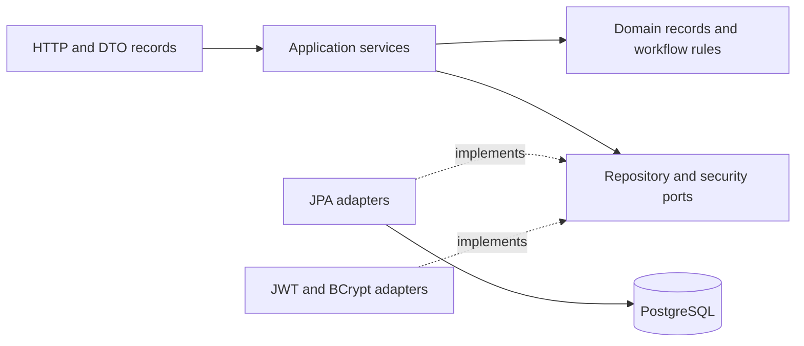
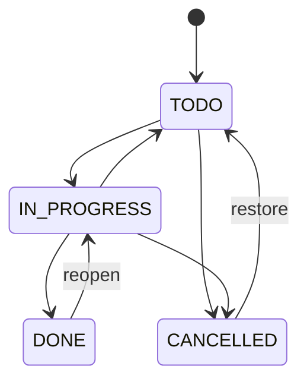

# Workboard — Java Spring Boot Backend

[](https://github.com/kinghouse12-wq/backend/actions/workflows/ci.yml)


**A layered project/task API that stays correct when requests are unauthorized, invalid, or concurrent.**

One service, one database, and a few complete workflows: JWT authentication, project ownership,
explicit task transitions, atomic version checks, and status history committed with the task.

## Review in five minutes

1. Follow [`TaskService.update`](src/main/java/dev/workboard/application/TaskService.java).
2. Inspect the [atomic database update](src/main/java/dev/workboard/infrastructure/persistence/TaskJpaRepository.java).
3. Read the [HTTP integration/failure tests](src/test/java/dev/workboard/ApiIntegrationTest.java)
   and [competing-writer test](src/test/java/dev/workboard/PostgresConcurrencyTest.java).
4. Check [design decisions](docs/architecture.md), then run the demo.

| Feature | What it demonstrates |
| --- | --- |
| Spring Security JWT | HS256 allowlist, required claims, issuer/audience/expiry validation |
| BCrypt password storage | Cost 12; dummy-hash verification for unknown accounts; no credential logging |
| Owned projects and tasks | Nested authorization, `404` for inaccessible resources, no ORM entities in responses |
| Version-safe task updates | `expectedVersion` compare-and-swap, `409` on stale writes |
| Transactional audit | Task and status event commit together; failure rolls both back |
| Persistence | Spring Data JPA, PostgreSQL, Flyway, UUIDs, foreign keys, composite indexes |
| Operations | Actuator readiness/liveness, ECS JSON logs, validated correlation IDs, non-root container |
| Quality | JUnit integration tests, ArchUnit boundaries, Spotless, JaCoCo coverage gate, real PostgreSQL/container CI |

## Architecture



```text
src/main/java/dev/workboard/
├── api/             # Controllers, validated DTOs, Problem Details, request IDs
├── application/     # Use cases, ports, transaction boundaries
├── domain/          # Immutable Java records and framework-free workflow rules
└── infrastructure/  # JPA, JWT/BCrypt adapters, configuration
src/main/resources/db/migration/  # Flyway schema
src/test/java/dev/workboard/      # Domain, architecture, API, concurrency tests
```

Controllers depend on application services. Application services use ports rather than JPA classes.
ArchUnit enforces those boundaries and a framework-free domain. Transactions are declared on
service methods; Open Session in View is disabled. Schema creation uses Flyway, not Hibernate DDL.

## Run

Prerequisites: Java 21, Docker with Compose, and OpenSSL. Maven is included through a checksum-verified
wrapper; a system Maven installation is optional. The HTTP demo additionally uses curl and jq.

```sh
git clone https://github.com/kinghouse12-wq/backend.git
cd backend
sh scripts/bootstrap.sh
docker compose up --build -d
curl --fail http://localhost:8080/actuator/health/readiness
bash scripts/demo.sh
```

If readiness is still starting, inspect `docker compose logs api` and retry. Boot runs Flyway and
validates the JPA schema before serving requests. The API binds to localhost:8080; PostgreSQL binds
to localhost:55433. `docker compose down` stops the stack and preserves the database volume.

**[Swagger UI](http://localhost:8080/swagger-ui.html)** · **[OpenAPI JSON](http://localhost:8080/v3/api-docs)**

For IDE/local development:

```sh
sh scripts/bootstrap.sh
docker compose up -d db
./mvnw spring-boot:run
```

The application loads the root `.env`; bootstrap generates random signing/database credentials and
does not overwrite an existing file. Docker gets those values through Compose. Keep `.env` private.

## API workflow

Register and obtain a token through `POST /api/v1/auth/register` and `/api/v1/auth/token`:

```json
{"email":"reviewer@example.com","password":"DemoPassword42!"}
```

Use the returned `accessToken` with `Authorization: Bearer <token>` or Swagger's Authorize dialog.
Create a project, then a task. Tasks start at version **0**, matching JPA's initial version.

```http
PATCH /api/v1/projects/{projectId}/tasks/{taskId}
Authorization: Bearer <token>
Content-Type: application/json

{"status":"IN_PROGRESS","expectedVersion":0}
```

The response has version `1`. Another edit with version `0` returns `409`. Validation/workflow errors
return `422`; malformed requests return `400`; unauthorized access returns `401` or resource `404`.
Errors use RFC 9457 Problem Details with stable `code` and `requestId` properties. Validation errors
omit raw input values. The response also includes `X-Request-ID`.



Every successful edit increments the version. Same-status updates add no duplicate event.
Omitted/null text fields stay unchanged; `clearDescription: true` explicitly clears the description.
Project deletion cascades tasks and their history. The demo creates test accounts and removes its project.

| Method | Path under `/api/v1` | Purpose |
| --- | --- | --- |
| POST | `/auth/register`, `/auth/token` | Register / log in |
| GET | `/auth/me` | Read authenticated user |
| POST / GET | `/projects` | Create/list owned projects |
| GET / DELETE | `/projects/{id}` | Read/delete a project |
| POST / GET | `/projects/{id}/tasks` | Create/list tasks; optional `status` filter |
| GET / PATCH | `/projects/{id}/tasks/{taskId}` | Read/update task |
| GET | `/projects/{id}/tasks/{taskId}/events` | Read status history |

Lists return `{items,total,page,size}`. Pages are zero-based, bounded to 0–500; size is 1–100.
Projects/tasks sort by creation time then UUID descending; events sort by task version ascending.
Probes live outside `/api/v1` at `/actuator/health/liveness` and `/actuator/health/readiness`.

## Verify

```sh
./mvnw spotless:check verify
```

The default suite uses H2 in PostgreSQL compatibility mode and the same Flyway migration as production.
The PostgreSQL race test skips locally until a real database is supplied. CI runs all tests on
PostgreSQL 17, checks formatting and the JaCoCo **80% line coverage** gate, then builds the Java
container and runs the real HTTP demo. JPA mapping boilerplate and the main launcher are excluded
from the coverage gate; business logic, controllers, adapters, and security remain included.

To test with a **disposable** PostgreSQL database (the integration suite deletes application data):

```sh
TEST_DATABASE_URL=jdbc:postgresql://localhost:55433/workboard_test \
TEST_DATABASE_USER=workboard TEST_DATABASE_PASSWORD=YOUR_TEST_PASSWORD \
./mvnw verify
```

JaCoCo report: `target/site/jacoco/index.html`. Format changes: `./mvnw spotless:apply`.

## Scope and next steps

This is a focused portfolio backend, with concrete correctness guarantees and [documented tradeoffs](docs/architecture.md).
Before public deployment, add HTTPS/ingress, gateway login rate limits, managed secrets/backups, and
account recovery/token revocation. Passwords are 12–72 characters and at most 72 UTF-8 bytes (BCrypt's limit).
Tokens expire after 15 minutes with 30 seconds of clock tolerance. CORS is closed unless origins are configured.
No performance or availability numbers are claimed without measurements.
